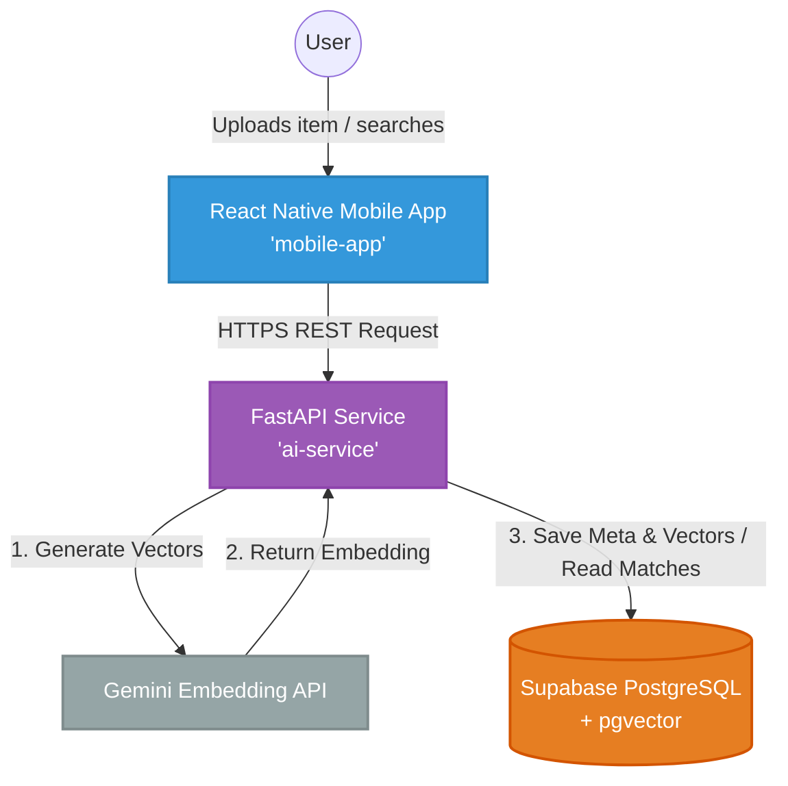

# FindIt

FindIt is an AI-powered lost-and-found platform that connects users with their missing items through intelligent image, description, location, and date-based matching.

## Project status

Currently under development for CS 160: Software Engineering at San José State University.

## Team 10 members

- Yug Amol More ([`Yug-More`](https://github.com/Yug-More))
- Marl Jonson ([`marlware`](https://github.com/marlware))
- Brody Smith ([`Brodys1`](https://github.com/Brodys1))

## Software architecture

- React Native (mobile interface: camera, GPS)
- FastAPI (single backend: users, claims, security, and AI embeddings)
- Supabase (storage, auth)
- Gemini API (vector embeddings)

### Diagram


## How to install

> **Status:** preliminary. The backend (`ai-service`) and database schema are runnable. The mobile app (`mobile-app`) supports sign-up, sign-in, browsing, search and filters, photos, My Reports, match review, and ownership claims. Signed-in users can submit, edit, and delete their own reports, claim another person’s open report, and approve or reject claims on reports they own. Notifications are available in mock mode. Live create and edit still depend on the backend Supabase and Gemini configuration, and photos need a Supabase Storage bucket.

### Prerequisites

- [Git](https://git-scm.com/)
- [Python 3.12+](https://www.python.org/downloads/) (needed for `ai-service`; avoid MSYS2/mingw Python builds, since they can't install some packages from PyPI)
- A [Supabase](https://supabase.com/) project (free tier) with the `vector` extension enabled
- A free [Gemini API key](https://aistudio.google.com/apikey) (used for embeddings)
- [Node.js](https://nodejs.org/) + npm (needed for `mobile-app`)

### Backend (`ai-service`)

1. Clone the repo and move into the backend:

   ```bash
   git clone https://github.com/Yug-More/find-it.git
   cd find-it/ai-service
   ```

2. Create a virtual environment and install dependencies:

   ```bash
   python -m venv .venv
   # Windows
   .venv\Scripts\activate
   # macOS/Linux
   source .venv/bin/activate

   pip install -r requirements.txt
   ```

3. Copy `.env.example` to `.env` and fill in your Supabase and Gemini credentials (see [`ai-service/README.md`](ai-service/README.md) for where to find each value).

4. Apply the database schema to your Supabase project: open the SQL editor and run [`database/schema.sql`](database/schema.sql).

5. Start the API:

   ```bash
   uvicorn app.main:app --reload
   ```

   It's now running at `http://localhost:8000`, with interactive docs at `http://localhost:8000/docs`.

See [`ai-service/README.md`](ai-service/README.md) for the full endpoint list and project structure.

### Database

Schema and seed instructions live in [`database/`](database/). Run [`schema.sql`](database/schema.sql) once per Supabase project; [`seeds.sql`](database/seeds.sql) has notes for adding local test data.

### Mobile app (`mobile-app`)

The app includes sign-up, sign-in, a profile screen, report photos, search and filters, My Reports, matches, claims, mock notifications, and edit or delete for the report owner. Sample data is on by default. A signed-in user submits, updates, deletes, claims, and reviews matches through the API with the Supabase access token. `GET /items` currently returns open reports, so the app filters that list on the device.

1. From the repository root:

   ```bash
   cd mobile-app
   npm install
   ```

2. Copy `.env.example` to `.env` and set `EXPO_PUBLIC_SUPABASE_URL` and `EXPO_PUBLIC_SUPABASE_ANON_KEY` when you want to sign in. Leave `EXPO_PUBLIC_USE_MOCK=true` to keep sample data on the device.

3. Start Expo:

   ```bash
   npm start
   ```

   Open the project in Expo Go, a simulator, or the browser with `npm run web`.

4. Checks:

   ```bash
   npm test
   npm run lint
   npm run typecheck
   ```

See [`mobile-app/README.md`](mobile-app/README.md) for environment variables, mock mode, and live submission. Do not put the Supabase service-role key, JWT secret, Gemini API key, or access tokens in the mobile app. Expo includes every `EXPO_PUBLIC_` variable in the client bundle.

### TODO

- add design decisions to README
