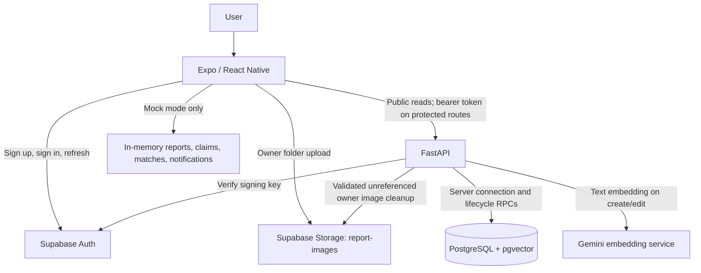
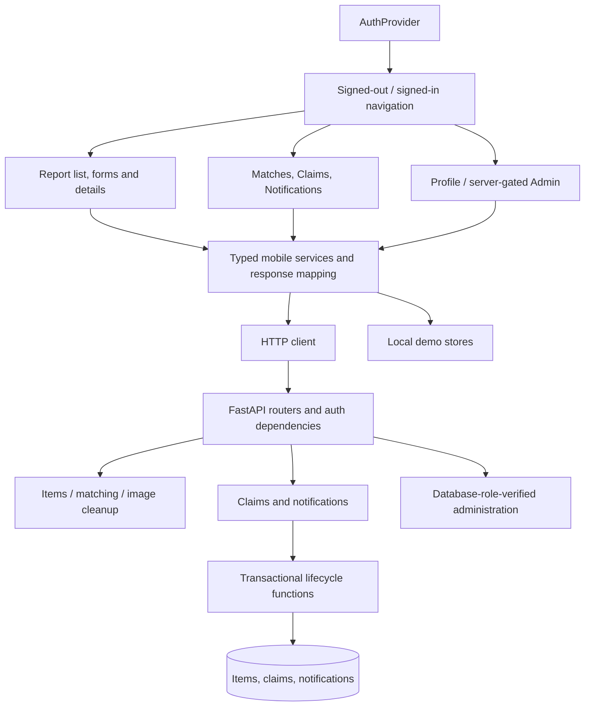
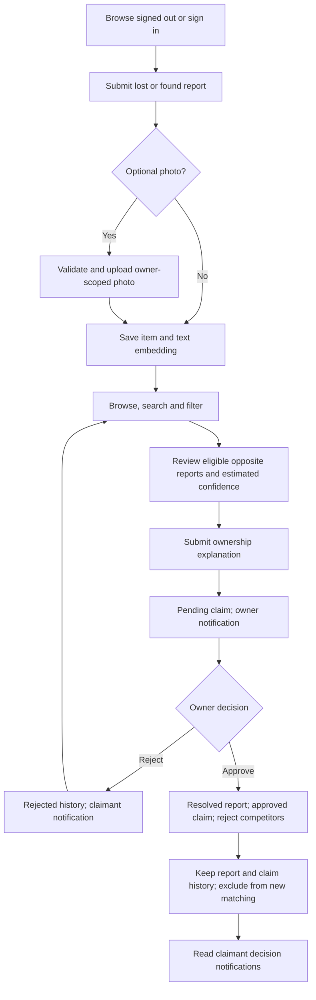

# Implemented workflow diagrams

These diagrams describe the current implementation. Mock mode calls local stores
instead of FastAPI/Supabase. The service topology is unchanged in Sprint 4; the
architecture/component views below include the already-merged lifecycle and admin work.

## Architecture



## Components



## Claim submission

```mermaid
sequenceDiagram
  actor Claimant
  participant App
  participant API as FastAPI
  participant DB as PostgreSQL
  Claimant->>App: Enter ownership explanation
  App->>API: POST /items/{id}/claims + bearer token
  API->>API: Verify subject; validate request
  API->>DB: submit_item_claim(item, verified actor, message)
  DB->>DB: Lock report; check open, non-owner, no active duplicate
  DB->>DB: Insert pending claim and owner notification atomically
  DB-->>API: Claim (or rollback with clear error)
  API-->>App: 201 claim / validation or authorization error
  App-->>Claimant: Claim history or retryable error
```

## Approval or rejection

```mermaid
sequenceDiagram
  actor Owner
  participant App
  participant API as FastAPI
  participant DB as PostgreSQL
  Owner->>App: Choose Approve or Reject; confirm
  App->>API: PATCH /claims/{id} + bearer token
  API->>DB: decide_item_claim(claim, verified actor, status)
  DB->>DB: Lock report then claim; require owner and pending claim
  DB->>DB: Store decision and claimant notification
  alt Approval on open report
    DB->>DB: Resolve report; reject other pending claims
    DB->>DB: Notify competing claimants
  else Rejection
    DB->>DB: Preserve report status and historical claim
  end
  DB-->>API: Commit all changes (or rollback all)
  API-->>App: Updated claim / 403, 404, 409
  App->>API: Reload claim and related report history
```

## Notification creation and retrieval

```mermaid
sequenceDiagram
  participant App
  participant API as FastAPI
  participant DB as PostgreSQL
  Note over API,DB: Lifecycle RPC controls recipient and creates claim events
  App->>API: GET /notifications + bearer token
  API->>DB: Select notifications for verified subject
  DB-->>App: Owned notifications through API
  App->>API: PATCH /notifications/{id}/read
  API->>DB: Check ownership; update is_read only
  DB-->>App: Updated notification through API
  App->>API: POST /notifications/read-all
  API->>DB: Mark only verified recipient's unread rows
  API-->>App: 204; update displayed read state
```

## Resolution and history

```mermaid
sequenceDiagram
  actor Owner
  participant App
  participant API as FastAPI
  participant DB as PostgreSQL
  Owner->>App: Confirm claim approval
  App->>API: PATCH /claims/{id}, status approved
  API->>DB: Atomic decide_item_claim
  DB->>DB: Item status open to resolved; preserve claims
  API-->>App: Approved claim
  App->>API: GET /items?status=open and status=resolved
  API-->>App: History including resolved report
  App->>API: GET /items/{id}/matches for resolved item
  API-->>App: Empty matches
  Note over Owner,DB: No independent physical-return confirmation is implemented
```

## Full recovery flow


